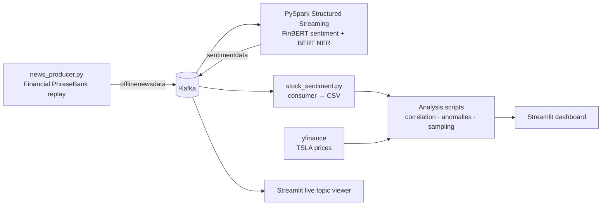

# Real-Time Market Sentiment

A streaming pipeline that scores financial news sentiment in real time with **Kafka** and **PySpark Structured Streaming**, then compares daily sentiment with stock prices and surfaces anomalies in a **Streamlit** dashboard.

## Architecture



1. **Produce:** `producer/news_producer.py` publishes 50 news records every 10 seconds to the Kafka topic `offlinenewsdata`.
2. **Score:** `spark_app/spark_sentiment_processor.py` reads the topic with Spark Structured Streaming, runs **FinBERT** (`ProsusAI/finbert`) for sentiment and **BERT NER** (`dslim/bert-base-NER`) to extract organization names, and writes enriched JSON to the topic `sentimentdata`.
3. **Collect:** `stock_analysis/stock_sentiment.py` consumes `sentimentdata` and saves dated sentiment labels to `output/sentiment_only.csv`.
4. **Analyze:** the scripts in `stock_analysis/` aggregate sentiment by day, join it with TSLA closing prices from yfinance and run the analyses below.
5. **Visualize:** `streamlit_dashboard_app.py` presents the results; `streamlit_kafka_viewer.py` shows the live `sentimentdata` stream.

## Analyses

| Script | What it does | Output |
|---|---|---|
| `lagged_correlation_analysis.py` | Maps sentiment to −1/0/+1, averages by day, joins with TSLA close prices and computes the same-day Pearson correlation | `merged_lagged_sentiment_stock.csv` |
| `anomaly_detection.py` | Flags days where sentiment or price is more than 2 standard deviations from the mean (z-score) | `sentiment_anomalies.csv`, `price_anomalies.csv` |
| `reservoir_sampling.py` | Draws a uniform 100-record sample from the sentiment stream with reservoir sampling | `reservoir_sampled_sentiment.csv` |
| `privacy_k_anonymity.py` | Aggregates sentiment by month and suppresses groups smaller than k = 5 | `k_anonymized_sentiment.csv` |
| `lsh_detection.py` | Finds near-duplicate phrases with TF-IDF vectors and cosine similarity above 0.9 | `lsh_similar_pairs.csv` |

## Data note

The pipeline runs on an offline replay of the **Financial PhraseBank** dataset. The producer wraps each phrase in a templated headline and assigns a **simulated publish date** within the last 90 days. The original NewsAPI producer is kept in `news_producer.py` (commented out) for live data.

Because the dates are simulated, the correlation and anomaly results show how the analysis pipeline works rather than a real link between news sentiment and stock prices. FinBERT was itself fine-tuned on Financial PhraseBank, so its accuracy on this replay data is higher than you would expect on live news.

`producer/twitter_producer.py` is an optional one-shot producer that publishes recent tweets to a `twitterdata` topic (requires a Twitter/X API bearer token). The Spark job does not consume that topic.

## Repository structure

```
real-time-market-sentiment/
├── docker-compose.yml            # Zookeeper, Kafka, Spark master + worker
├── Dockerfile                    # Spark image with the Python dependencies
├── spark-submit.sh               # builds and runs the Spark job
├── requirements.txt
├── producer/
│   ├── news_producer.py          # Financial PhraseBank replay → offlinenewsdata
│   └── twitter_producer.py       # optional: recent tweets → twitterdata
├── spark_app/
│   └── spark_sentiment_processor.py
├── stock_analysis/               # consumer + analysis scripts
├── streamlit_dashboard_app.py    # results dashboard
└── streamlit_kafka_viewer.py     # live topic viewer
```

## Run it locally

**Prerequisites:** Docker, Python 3.10+, and the Financial PhraseBank CSV saved as `financialphrasebank.csv` in the repo root. The producer reads the phrase from the first column.

Run every command from the repo root.

```bash
# 1. Start Kafka, Zookeeper and Spark
docker compose up -d

# 2. Install Python dependencies
python -m venv .venv && source .venv/bin/activate
pip install -r requirements.txt

# 3. Start the producer (leave it running)
python producer/news_producer.py

# 4. In a new terminal, build and start the Spark streaming job
./spark-submit.sh

# 5. Collect scored records and run the analyses
mkdir -p output
python stock_analysis/stock_sentiment.py
python stock_analysis/lagged_correlation_analysis.py
python stock_analysis/anomaly_detection.py
python stock_analysis/reservoir_sampling.py
python stock_analysis/privacy_k_anonymity.py
python stock_analysis/lsh_detection.py

# 6. Open the dashboards
streamlit run streamlit_dashboard_app.py
streamlit run streamlit_kafka_viewer.py
```

The first Spark run downloads the FinBERT and BERT NER models from Hugging Face, so it takes a few minutes to start scoring.

## Tech stack

Apache Kafka · PySpark Structured Streaming · Hugging Face Transformers (FinBERT, BERT NER) · pandas · SciPy · scikit-learn · yfinance · Plotly · Streamlit · Docker
